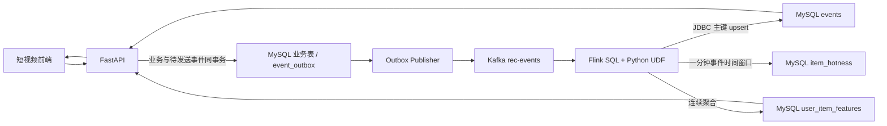

# 映刻 · 短视频实时推荐系统

前端短视频平台 + FastAPI + MySQL + Kafka + Flink SQL / Python UDF。所有业务、行为明细、推荐特征、窗口热度及模型元数据统一保存到 **MySQL**。模型二进制制品保存在持久目录，MySQL 保存其版本与校验和。

## 本地运行（使用现有 MySQL）

连接参数保存在被 Git 忽略的 `.env`，已按本地连接配置。数据库默认为 `yingke`；初始化只创建缺失数据库和表，不删除现有数据或修改数据库账号。

```bash
# 第一次使用可复制模板后填写连接；已有 .env 时不要覆盖
# cp .env.example .env
bash scripts/dev.sh
```

开发脚本安装依赖，执行 MySQL 初始化，再启动 API。打开 http://127.0.0.1:8000 ，接口文档 http://127.0.0.1:8000/docs 。首次使用在登录页注册账号；业务接口只使用登录令牌鉴权。数据库凭据只放在 `.env`，不要写入版本控制。

- `REC_MODE=demo`：业务、行为、特征仍然全部写 MySQL；行为从 Outbox 直接投递到 MySQL，并在事务中更新用户视频特征，便于不启动 Kafka/Flink 时验证交互。
- `REC_MODE=production`：业务与 Outbox 写 MySQL，后台投递 Kafka，Flink SQL / Python UDF 计算后经 JDBC 写回同一 MySQL 的 stream_* 表。
- `SEED_CATALOG=1`：只插入缺失的 6 个演示创作者和 24 个演示视频，普通重启不覆盖已有编辑内容；若检测到多条视频指向同一片源，会自动修复为 24 条互不重复的演示目录。
- `SEED_ANALYTICS=1` 且 demo 模式：仅当行为表为空时创建 650 条固定种子模拟历史。正式数据环境设置为 0。

项目早期的本地演示数据可通过 `.venv/bin/python -m scripts.migrate_demo_to_mysql` 迁入当前 MySQL。该脚本仅允许 demo 模式，保留源文件，对已有主键不覆盖；导入模型保持未启用，以保留当前线上版本。

默认应用运行不会使用 SQLite。代码中的 SQLite 适配器仅用于隔离测试，完整 MySQL 集成测试使用独立 `_test` 库。


## 接入现有 master 集群（当前环境）

已验证 Kafka `master:9092`、Flink `http://master:8081`（1.18.1），本地安装位于 `/usr/local/soft/flink-1.18.1`。继续使用现有 Kafka/Flink，**无需启动 Compose**。没有修改集群安装目录或已有 topic。

实时作业现在按 `Flink SQL.md` 的方式提交：SQL DDL、SQL DML、Python UDF、`sql-client.sh -f`、`flink-conf.yaml` 中的 checkpoint 配置，以及 `execution.savepoint.path` 恢复。三个 `INSERT` 放在一个 `EXECUTE STATEMENT SET` 中，因此仍是一个 Flink 作业、一个 Job ID、一个 savepoint。`scripts/stream.py` 只负责准备 topic/表、渲染 SQL、调用 SQL Client、记录 Job ID。

当前集群是 standalone；`yarn-session.sh` 依赖的 Hadoop YARN 类不在本机 Flink 安装中，SQL Client 直接使用 `FLINK_REST_URL` 的 REST 地址提交（`-Drest.address` / `-Drest.port`）。SQL 语法、连接器、Python UDF 与恢复流程均按文档执行。

`.env` 已配置 `KAFKA_BOOTSTRAP_SERVERS`、`KAFKA_TOPIC`、`FLINK_REST_URL`、`FLINK_HOME`、`FLINK_PYTHON`、`FLINK_JOB_ID`，并切换 `REC_MODE=production`。执行 `bash scripts/dev.sh` 即可让业务 API 使用当前实时作业。

```bash
# 初次准备专属 topic 和缺失的 MySQL 表
.venv/bin/python -m scripts.stream prepare
# 提交 SQL Client 作业（检测到同一实时作业运行时拒绝重复提交）
.venv/bin/python -m scripts.stream submit
# 第一次冷启动时回放已有演示历史，保留原 event_id
.venv/bin/python -m scripts.stream replay
```

当前实时作业已切换为 SQL Client 版本：`yingke-realtime-recommendations` 正在运行，`FLINK_JOB_ID` 与 `runtime/flink-job.json` 已指向新 Job ID。本次按“直接删除旧任务”的要求没有做 savepoint 迁移，新作业从 Kafka 重新消费并由 checkpoint 持续保存状态；不要同时运行两个写同一组 `stream_*` 表的作业。

实时结果写入 `stream_events`、`stream_user_item_features`、`stream_item_hotness`，API 在 production 模式只读取这些表；原 `events` 等演示表完整保留。这样不会用一份不完整的流聚合覆盖历史演示特征。正常业务 API 的新事件只通过 Kafka 入流。

checkpoint 配置按文档写入 `flink-conf.yaml`：10 秒间隔、`EXACTLY_ONCE`、`RETAIN_ON_CANCELLATION`、单并发 checkpoint、HDFS/共享目录。容器方案在 `compose.yaml` 的 `FLINK_PROPERTIES` 中使用同一组配置。Python worker 初次启动可能需要几十秒；窗口热度需要 watermark 推进，最后一个未结束窗口不会立即输出。健康探测以最近一次完成 checkpoint 为准。

恢复已有数据状态时，先对当前作业保存 savepoint 并停止，再指定恢复路径提交：

```bash
.venv/bin/python -m scripts.stream submit --restore file:///absolute/path/to/savepoint
```

恢复前 SQL Client 会先执行 `SET 'execution.savepoint.path' = '...'`，再执行 Statement Set。禁止清空 Kafka topic 或特征表来替代恢复。新机器/多机部署时，需要所有 worker 可访问的共享 checkpoint 目录；当前本地文件路径只适用于这一台集群主机。Docker 方案仍为独立的 1.20 环境，不能直接与本机 1.18 的 checkpoint/运行作业混用。

推荐控制台现在实际探测 Kafka topic、指定 Flink 作业和最近 checkpoint（5 秒缓存），显示连接失败、运行异常或 checkpoint 过期；不再仅以“已配置”代表健康。

## 可选容器集群

以下 Compose 仅供独立环境使用，不要与当前 master 服务同时占用端口或写同一组实时表。Compose 默认连接已有 MySQL，不启动新的数据库容器，避免与本机 3306 端口冲突。宿主 Python 使用 `MYSQL_HOST=localhost`；容器内使用 `MYSQL_DOCKER_HOST=host.docker.internal`。如果 MySQL 位于其他机器，设置对应主机。数据库必须允许容器网络的连接；本机验证成功不代表容器网络已验证。

```bash
docker compose up -d --build
docker compose logs mysql-init flink-submit taskmanager
```

需要 Docker Engine、可用镜像网络和足够内存。API 地址 http://127.0.0.1:8000 ，Flink UI http://127.0.0.1:8081 。本地服务与容器 API 共用 8000，启动容器前应停止本地 API。



行为 API 在 MySQL 业务状态和 Outbox 提交后返回 202，不等同于 Kafka/Flink 已处理。Publisher 失败后保留待发事件并重试；崩溃时可能重复投递，因此复用原 `event_id`，Flink 按事件 ID 去重。

Flink JDBC SQL sink 采用至少一次投递和主键 upsert，不是跨表原子提交或 XA Exactly Once。用户物品特征写入聚合后的绝对值，重复写入不会重复累加；各表可能短暂不同步。sink 每 1 秒或 100 行刷新，checkpoint 每 10 秒。恢复任务应指定 checkpoint/savepoint，不能用全新提交替代恢复；不要同时运行多个写入同一特征表的作业。

事件窗口依赖 watermark，空闲输入时不会立刻产生窗口结果。`item_hotness` 用于窗口分析；当前 Trending 算法对最近行为实时衰减，未读取窗口表。demo 模式不模拟窗口任务，也不声称运行了 Flink。

从 demo 切换到实时模式会改读独立的 stream_* 表，需关闭演示种子并完成历史回放。原业务表与演示历史保留。不要把直接计算和 Flink 两条链路写入同一组特征表。

## MySQL 数据表

| 表 | 职责 |
| --- | --- |
| users | 用户与创作者资料 |
| accounts | 登录用户名与 PBKDF2 密码哈希（不存明文密码） |
| auth_sessions | Bearer 会话的 SHA-256 摘要、过期时间与最近使用时间 |
| videos | 视频元数据、作者、发布状态、初始演示热度 |
| video_interactions | 点赞和收藏当前状态 |
| follows | 关注关系 |
| event_outbox | 持久事件、投递状态和重试次数 |
| events | 去重行为明细与行为权重 |
| user_item_features | 用户视频偏好、交互数、最后事件时间 |
| item_hotness | 一分钟窗口热度 |
| model_versions | 模型任务、配置、评估、校验和与启用状态 |

采用 InnoDB、utf8mb4、区分大小写的主键和必要索引。时间戳秒数使用 DOUBLE，事件毫秒使用 BIGINT，避免单精度浮点造成排序误差。`scripts/init_mysql.py` 会将早期原型的单精度时间列和特征列无损扩宽（不会还原已经丢失的小数精度）。初始结构参考 `infra/mysql/schema.sql`；尚未引入通用数据库迁移系统。

`MYSQL_HOST`、`MYSQL_PORT`、`MYSQL_DATABASE`、`MYSQL_USER`、`MYSQL_PASSWORD` 控制连接。模型文件由 `MODEL_DIRECTORY` 指定，Compose 使用 `app-runtime` 持久卷。备份应同时包含 MySQL 和模型目录。

## 短视频前端

- 推荐流支持滚轮/触摸/上下键切换、空格播放暂停、静音、进度拖动和全屏。
- 点赞、收藏、关注支持取消；状态从服务端读取，刷新后保留。
- 分类、搜索、关注列表、收藏夹、链接分享、算法切换与推荐原因。
- 观看满 2 秒、观看满实际时长 80%、快速跳过会采集行为；当前队列保持稳定，重新加载时根据最新行为推荐。
- 首次访问显示登录/注册页；用户名 3–32 位字母、数字或下划线，密码至少 8 位。登录后会话令牌保存在浏览器 `localStorage`，刷新保持登录，退出登录后失效。

当前 24 条视频分别使用 Mixkit 的 24 个不同素材，按分类选择，使用公开提供的 360p 预览版本；标题与封面对应实际素材，作者为演示账号，初始热度为演示数据。每条的来源页面、许可链接、原始高清链接保存在 `backend/video_sources.json`。视频已下载后从本地 `/media/videos/<sha256>.mp4` 播放；字体和封面仍需要外网。

## 推荐算法与模型训练

已实现 15 种算法：Popular、Trending、Content、UserCF、ItemCF、Slope One、SVD、BPR-MF、Association、Session、Hybrid、MMR，以及可离线训练的 Implicit ALS、FM、双塔神经网络。

- Content 使用类别 one-hot，不是视频语义向量。Session 使用最近交互的一阶转移，按用户历史近似会话。
- SVD 为截断分解，BPR 为隐反馈成对 SGD，MMR 按类别相似度做贪心多样性重排。
- ALS 优化置信度加权隐反馈目标；FM 使用用户/视频/类别的二阶因子交叉；双塔使用独立 Embedding + tanh 全连接与点积匹配。
- ALS/FM/双塔采用离线制品加载，不在推荐请求中训练；传统 SVD/BPR 仍在请求中计算，仅适用于小规模验证。

打开「推荐控制台」→「模型训练实验室」，选择模型、轮数和向量维度，提交训练，查看评估后启用版本。支持停用、历史版本回滚和在线体验。未启用模型时选项禁用，API 返回 409；已有模型停用后回到推荐页面会切换混合推荐。未知用户热门回退，新视频热门补齐，响应明确标注。

按全局事件时间约 80/20 切分，同一时间戳全部位于同一侧。训练只使用较早反馈，后续标签不参与采样和梯度；在完整目录评估已知用户对未交互视频的后续正反馈，输出 Recall@5、NDCG@5、Coverage@5 和热门基线。无可评估用户时指标为 null，不伪造为 0。未交互项不是确证负反馈，目录元数据是当前快照，演示指标不能代表真实效果。

模型 NPZ 制品包含参数、训练矩阵、验证集合与配置，原子写入，加载禁用 pickle，启用与首次加载时验证 SHA-256。元数据留在 MySQL。当前训练器限定单进程、单任务；不要启动多个 Uvicorn workers 或多个训练管理器共享业务库。重启会把旧排队/运行任务标记为失败，完成模型仍可加载。规模上限为 1000 用户、500 视频、向量维度 4–32、轮数 1–50，尚无 ANN 或分布式训练。

FFM、Wide & Deep、DeepFM、DCN、DIN/DIEN、SASRec/BERT4Rec、LightGCN、MMoE/PLE 和上下文 Bandit 尚未实现；不声称覆盖所有工业推荐算法。

## API

业务 API 使用账号登录作为唯一鉴权方式：除注册、登录、健康检查、视频目录和本地媒体外，均需携带 `Authorization: Bearer <token>`。用户身份只取自已验证的会话，客户端不能通过 `user_id` 冒充其他用户；`user_id` 与服务端会话不一致时返回 403。

认证接口：

- `POST /api/auth/register`（公开）：`{"username":"alice","password":"至少8位","name":"可选昵称"}`，返回 `token`、`expires_at` 与 `user`。
- `POST /api/auth/login`（公开）：`{"username":"alice","password":"..."}`，返回新的 Bearer 令牌。
- `GET /api/auth/me`、`POST /api/auth/logout`（需 Bearer 令牌）：读取当前用户、撤销当前令牌（204）。
- 会话默认 30 天过期，可用 `AUTH_TOKEN_TTL_DAYS` 调整；数据库只保存令牌的 SHA-256 摘要。

其余接口：

- `GET /api/health`：存活与当前模式，公开。
- `GET /api/videos`：公开视频目录。
- `GET /api/me/state`、`GET /api/users/{user_id}/state`：当前用户互动状态；后者只能访问自己的 ID，需登录。
- `POST /api/events`：`{"item_id":"v001","action":"like","event_id":"unique-id"}`。`user_id` 可省略；若提供则必须等于当前登录用户。支持 view/complete/skip/like/unlike/favorite/unfavorite/follow/unfollow；重复相同 ID 幂等，冲突载荷返回 409。
- `GET /api/recommendations?algorithm=hybrid&limit=12`：按当前登录用户推荐；`user_id` 可省略，提供时必须是本人。
- `GET /api/metrics`、`GET /api/business/status`：采样统计与待投递数量，需登录；Kafka/Flink 按配置实际探测，MySQL 查询成功仅代表查询链路可用。
- `GET /api/algorithms`、`GET /api/models`、`GET /api/models/{id}`，需登录。
- `POST /api/models/train`：`{"algorithm":"two_tower","epochs":20,"factors":12,"seed":42}`。
- `POST /api/models/{id}/activate`、`POST /api/models/{id}/deactivate`。

分析读取限制为最近 20,000 条行为/特征。采样统计不是全站指标，推荐分数不是 CTR。API 启动不代表 Kafka/Flink 作业健康。

## 验证

```bash
.venv/bin/python -m pytest backend/tests -q
node --check frontend/app.js
node --check frontend/models.js
docker compose config --quiet
```

真实 MySQL 测试需要提前创建独立、以 `_test` 结尾的数据库，并加载连接环境变量：

```bash
# 使用已有 .env 的凭据；测试不使用 yingke 业务库
.venv/bin/python - <<'PY'
from dotenv import load_dotenv
load_dotenv('.env')
import os, pytest
os.environ['MYSQL_TEST_DATABASE']='yingke_rec_test'
raise SystemExit(pytest.main(['backend/tests','-q']))
PY
```

测试覆盖算法、事务回滚、互动状态与去重、Outbox 重试、真实 MySQL 行为/特征与模型版本、训练梯度差分、时间切分隔离、排名指标、制品校验、训练失败/忙碌、版本回滚、重启、账号注册登录、令牌撤销/过期与跨用户越权拦截。当前 master 集群已完成 API → Outbox → Kafka → Flink SQL Client/Python UDF → MySQL、事件重复发送去重和 checkpoint 验证；SQL Client 版本已切换为线上作业；Compose 独立容器环境仍未运行。

## 文件与技术参考

- `backend/business.py`：业务表与事务。
- `backend/analytics_schema.py`、`backend/store.py`：统一 MySQL 行为和特征。
- `backend/training/`：训练、评估、制品与版本。
- `infra/flink/`：SQL Client 脚本、Kafka → Flink SQL/Python UDF → MySQL JDBC。
- `infra/mysql/schema.sql`：初始数据库结构。
- `scripts/init_mysql.py`、`scripts/dev.sh`：初始化与启动。
- `Flink SQL.md`：原有学习笔记，保留未改。

参考：[Flink JDBC SQL Connector](https://nightlies.apache.org/flink/flink-docs-release-1.20/docs/connectors/table/jdbc/)、[Flink Python 依赖管理](https://nightlies.apache.org/flink/flink-docs-release-1.20/docs/dev/python/dependency_management/)。

## 本地视频

执行 `.venv/bin/python -m scripts.download_videos` 会读取 MySQL 中全部视频（含未发布记录），将远程片源按实际内容 SHA-256 去重下载到 `runtime/media/videos/`，保存下载清单 `runtime/media/manifest.json`，然后在事务中更新视频播放 URL。当前 24 条演示记录各有独立片源，播放 URL 和文件内容哈希均不重复；早期 3 个测试片源已清理。

下载先写临时文件，验证 MP4 文件头和完整长度后原子保存；有失败时不切换数据库播放地址。再次运行会复用经过校验的本地文件，且不会覆盖下载期间其他人修改的视频地址。新初始化的演示目录会优先使用已存在的本地下载清单。

本地视频接口支持 HTTP Range / 206、拖动进度、HEAD 和不可变缓存，媒体文件无需登录令牌，播放地址使用内容哈希；仅允许访问视频目录中的 MP4 文件。`MEDIA_DIRECTORY` 可以配置媒体根目录（默认项目 `runtime/media`）。Compose 额外挂载 `./runtime/media:/app/runtime/media:ro`，已有下载无需在容器内重复下载；迁移机器时需同步此目录。


### 一条记录对应一个独立片源

`backend/video_sources.json` 固定 24 个不同素材来源；使用 Mixkit 官方页面公开的预览文件，保留原高清地址、来源页和许可链接。`.venv/bin/python -m scripts.provision_unique_videos` 可重新下载/校验全部素材：支持 curl 断点续传，解析 MP4 的实际时长和尺寸，并在更新 MySQL 前校验 24 个内容 SHA-256 全部不同。所有视频下载成功且无重复后，才在事务中更新播放地址、标题、对应封面与实际时长。视频 ID、类别和用户互动保持不变。下载期间若目录地址被其他人修改，会停止覆盖。

当前素材为 360p 预览清晰度，用于本地功能演示；原始高清版本总量超过 1GB，未在此任务中下载。验收与来源清单保存到 `runtime/media/unique-catalog.json`。
